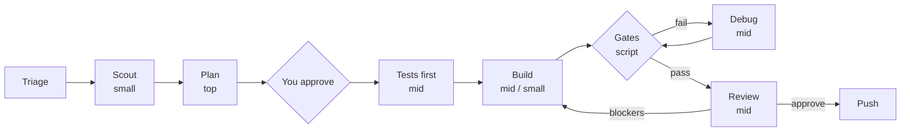

# TierwiseAgents

**The right model for every job.** A Claude Code plugin that routes each piece of development work to the cheapest model tier that can do it well, and does not let the result be pushed until it has been tested and reviewed.

[](LICENSE)

Most coding sessions run everything on one expensive model: the planning, the typing, the renaming, the re-running of tests. Only the first of those needs it. TierwiseAgents splits the work:

- **Top tier decides.** One strong model makes the design decisions and writes them into a plan.
- **Mid tier builds.** Tests, implementation, debugging and review follow that plan.
- **Small tier does the chores.** Reading the codebase, renames, moves, formatting.
- **A script, not a model, says "it passes".** Lint, types, tests, build and a smoke check gate every push.

Works with any Claude model, and with non-Claude models through the coding CLIs you already use (Codex CLI, Gemini CLI, opencode, aider).



## Quick start

```
/plugin marketplace add prayag17/ModelOrchestrator
/plugin install tierwise-agents@prayag17
/tierwise-agents:orchestrate add rate limiting to the public API
```

## The roles

| Role | Tier | Default model | Does |
|---|---|---|---|
| `tw-scout` | small | `haiku` | Maps the relevant code, conventions and check commands before planning |
| `tw-architect` | top | `opus` (or `fable` if you allow it) | Makes the design decisions and writes the plan |
| `tw-tester` | mid | `sonnet` | Writes tests from the plan before the code exists |
| `tw-builder` | mid | `sonnet` | Implements one planned task |
| `tw-runner` | small | `haiku` | Renames, file moves, formatting, find and replace, boilerplate |
| `tw-debugger` | mid | `sonnet` | Finds the root cause of a failing check and fixes it |
| `tw-reviewer` | mid | `sonnet` | Reviews the final diff against the plan, read-only |

## The cycle

1. **Triage.** The cycle is sized to the task. A small edit is done inline, a rename goes straight to the small model, and only real design work gets the full cycle.
2. **Scout.** A small model does the reading, so the top model does not spend its tokens exploring.
3. **Plan.** The architect writes a self-contained plan: decisions, a risk level, the gates, and tasks that each name a role, a test mode and an acceptance check. You approve it before anything is built.
4. **Tests first.** For tasks that warrant it, a tester writes failing tests from the plan without seeing the implementation. The builder must make them pass and may not edit them.
5. **Build.** Each task goes to its role with nothing but the plan path and task id. Independent tasks run in parallel. A task that fails or is blocked moves up one step; nothing is retried by the same role.
6. **Gates.** A script runs lint, typecheck, tests, build and a smoke check, and records exactly which code passed. A failure goes to the debugger for a root cause. Weakening a check to make it pass is not allowed.
7. **Review.** A fresh reviewer reads the diff against the plan and reports only real defects. High-risk changes are reviewed by the top model. Blockers are fixed, then the gates run again.
8. **Push.** Only on your request, and only when the commit being pushed is the code that passed. With the plugin installed, a hook blocks `git push` otherwise.

## Install

### As a plugin (recommended)

```
/plugin marketplace add prayag17/ModelOrchestrator
/plugin install tierwise-agents@prayag17
```

Then run `/tierwise-agents:orchestrate <task>`, or just describe a multi-step feature and the skill activates on its own. The plugin includes the agents and the push guard.

### As a standalone skill

```bash
git clone https://github.com/prayag17/ModelOrchestrator
cp -r ModelOrchestrator/skills/orchestrate ~/.claude/skills/orchestrate   # or .claude/skills/ in a project
python3 ~/.claude/skills/orchestrate/scripts/setup.py --scope user         # optional: installs the agents
```

Then run `/orchestrate <task>`. Without the setup step the skill still works, using general-purpose subagents on the tier models. The standalone skill has no push hook; the gates are enforced by the skill's instructions only.

## Choosing models

Defaults are `opus` / `sonnet` / `haiku`. To change them, run the setup script from the skill folder:

```bash
python3 scripts/setup.py --allow-fable                 # plan with Fable
python3 scripts/setup.py --top claude-opus-5-5 --mid claude-sonnet-5-5 --small claude-haiku-5-5
python3 scripts/setup.py --role reviewer=opus          # one role on a stronger model
python3 scripts/setup.py --scope user                  # apply to all your projects
```

or write `.claude/tierwise.json` yourself:

```json
{
  "allowFable": true,
  "tiers": { "mid": "sonnet", "small": "haiku" },
  "roles": { "reviewer": "opus" }
}
```

Fable is never used unless `allowFable` is set or you ask for it in the request. For a single run, just say so: "orchestrate this, plan with fable".

### Non-Claude models

Any tier or role can run on another vendor's or a local model by pointing it at a coding agent CLI you already use (Codex CLI, Gemini CLI, opencode, aider, or your own script):

```json
{
  "tiers": {
    "top": "opus",
    "mid": { "command": "codex exec --full-auto -m <model> {prompt}" },
    "small": { "command": "opencode run -m <provider/model> {prompt}" }
  }
}
```

TierwiseAgents hands that tool the same brief a Claude subagent would get, runs the acceptance check itself, and escalates on failure as usual. Models behind a Claude-compatible gateway also work by ID. Details and caveats are in [configuration](skills/orchestrate/references/configuration.md#non-claude-models).

## Quality gates

The architect writes the gates into each plan from the commands your project already has. To fix them for a project instead:

```bash
python3 scripts/setup.py --gate lint='npm run lint' --gate test='npm test' --gate build='npm run build'
```

Once a gate run has been recorded in a repository, Claude cannot `git push` unless the last run passed and `HEAD` is that same code. This guards pushes made by Claude; it does not replace branch protection on your Git host, and it does not cover deploy commands. See [quality gates](skills/orchestrate/references/configuration.md#quality-gates).

## Getting the most out of it

- The session you type in is billed too. Since the planning is delegated, running the session itself on a mid-tier model (`/model sonnet`) saves the most.
- Add `.tierwise/` to your project's `.gitignore`, or commit the plans if you want a record.
- Give the project a smoke check (a script that runs the real thing once). It is the gate that catches "tests pass but it does not work".

## Layout

```
.claude-plugin/          plugin and marketplace manifests
hooks/hooks.json         the push guard
skills/orchestrate/
  SKILL.md               the router
  agents/                the seven tw-* agents
  references/            plan format, configuration
  scripts/setup.py       writes config and pins models into the agents
  scripts/gate.py        runs the gates and guards pushes
  scripts/run_tier.py    resolves models; runs a role on an external CLI
  scripts/tw_config.py   shared config loading
```

## Contributing

Issues and pull requests are welcome, especially command shapes for other coding CLIs and reports from real projects on where a cheaper tier was enough and where it was not.

## License

MIT
